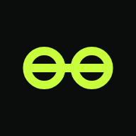

<div align="center">



# LiftLens

**Film a set, get measured. Your own AI coach reviews it — your videos never leave your device.**

Pose estimation, bar tracking and rep counting run entirely in the browser. Coach reviews come from the AI *you* choose: a cloud API with your own key, or the Claude Code / Codex already logged in on your computer — even from your phone.

English · [简体中文](README.zh-CN.md)

[](LICENSE)


</div>

> [!NOTE]
> The app UI and the coach reviews are in Simplified Chinese. The code, docs and APIs are in English.

## Features

- **Video analysis in the browser** — MediaPipe Pose or OpenMMLab RTMO (downloaded on demand), barbell colour tracking, automatic rep segmentation and rule checks for bench / squat / deadlift and 800+ library exercises. Every threshold is normalised to the lifter's body proportions, and every finding links to its source.
- **Training mode** — paste a plan, film each set (or count reps live with the camera and voice cues). Sets are analysed in the background while you rest; the next set suggestion is ready by the time you are.
- **Bring your own coach** — five coaching "skills" (IPF referee, NSCA-CSCS, Eastern-European periodisation, rehab PT, general fitness) run on:
  - a **cloud API** straight from the browser (Claude, OpenAI, Gemini, OpenRouter, Qwen, Doubao, Kimi, SiliconFlow, DeepSeek or any OpenAI-compatible endpoint), or
  - a **local agent** on your computer that drives Claude Code, Codex CLI, Gemini CLI, Qwen Code, OpenCode, Ollama or LM Studio.
- **Phone ⇄ computer relay** — scan a QR code and your phone uses the agent on your computer, from any network. End-to-end encrypted (AES-256-GCM); the relay only sees ciphertext.
- **Local-first** — training logs and videos live in the browser's IndexedDB. Export / import backups as JSON. Installable as a PWA.
- **Progress** — estimated 1RM and form-score trends, recurring faults, weekly muscle map, and an AI progress report.

## How it works

```
┌──────────────────── Browser (web/) ────────────────────┐
│ Pose model ──► 33 keypoints / frame                    │
│ Bar tracker ─► bar path + rep segmentation             │      cloud API (your key)
│ Rule engine ─► findings + sourceIds                    │ ───────────────────────────► Claude / OpenAI / …
│ IndexedDB ───► training log, videos                    │
└───────────────┬────────────────────────▲───────────────┘
                │ measurements + key frames (no video)
                ▼                        │
  ┌──── Local agent (agent/) ────┐       │   phone? ── E2E-encrypted relay (worker/) ──┐
  │ 127.0.0.1:4517, pairing token│ ◄─────┴─────────────────────────────────────────────┘
  │ Claude Code / Codex / Ollama │
  └──────────────────────────────┘
```

The program does the **measuring**; the coach does the **judging**. Keeping the two apart makes the numbers reproducible, and lets the coach cross-check them against annotated key frames (e.g. an arm hidden behind a plate).

## Quick start

### Use it

Open the hosted app, or your own deployment (see [Deploy](#deploy)), then pick how the coach runs under **AI Coach**:

| | What you need |
|---|---|
| **Cloud API** | An API key from any supported provider. Works on phones. |
| **Local agent** | Node.js 20+ and a logged-in Claude Code / Codex / … on your computer. Run the one-line `npx` command shown on that page. |
| **Phone → your computer** | The local agent running, then scan the QR code shown on the computer. |

### Develop

```bash
git clone <this repo> && cd liftlens
npm run setup   # install web + agent dependencies
npm run dev     # web on http://localhost:5180 + local agent on 127.0.0.1:4517
```

| Command | |
|---|---|
| `npm run web` | Web app only (Vite) |
| `npm run agent` | Local agent only (`node agent/src/cli.mjs`) |
| `npm run build` | Production build of the web app |
| `cd web && npx tsc -b && npm run lint` | Type-check and lint |

Optional: copy `.env.example` to `.env` (and `web/.env.local`) to point local development at a hosted relay.

### Local agent CLI

```bash
npx -y <site>/agent/liftlens-agent.tgz            # start and pair with the browser
npx -y <site>/agent/liftlens-agent.tgz install    # run in the background, start at login (macOS / Linux)
npx -y <site>/agent/liftlens-agent.tgz phone      # QR code to use this computer from your phone
npx -y <site>/agent/liftlens-agent.tgz use <id>   # switch runtime, e.g. `use qwen --key … --model …`
npx -y <site>/agent/liftlens-agent.tgz runtimes   # list runtimes and their status
```

## Deploy

LiftLens is a static site plus one small Worker (asset guard + relay) on Cloudflare Workers.

```bash
cp .env.example .env          # set LIFTLENS_SITE to your workers.dev / custom domain
npx wrangler login
scripts/deploy.sh             # builds the web app, packs the agent, deploys
```

The deploy script also publishes the coach skills and a versioned agent tarball next to the app, so users can run the agent with `npx` without an npm account.

## Project structure

```
liftlens/
├── web/        React 19 + Vite + Tailwind app
│   └── src/lib/      pose models, rule engine (analyze.ts), movement patterns, cloud runner, relay client
├── agent/      local agent: Hono server, runtimes, relay client, CLI
├── worker/     Cloudflare Worker: asset 404 guard + Durable Object relay
├── coaches/    coach skills (SKILL.md + references) and shared protocol, metrics, sources
└── scripts/    deploy, data builders (exercise library, muscle map)
```

## Pose models

| Model | Engine | Size | Notes |
|---|---|---|---|
| Lite / Full / Heavy | MediaPipe Pose Landmarker | 5.5 / 9 / 29 MB | 33 keypoints incl. heels and toes |
| RTMO-s / RTMO-m | OpenMMLab RTMO via onnxruntime-web (WebGPU, falls back to WASM) | 40 / 89 MB | One-stage multi-person; steadier in crowded gyms; no heel / toe points |

Both engines are mapped to the MediaPipe 33-point layout, so lifter selection and the rule engine don't depend on the model.

## Privacy

- Videos and training logs are stored only in your browser.
- A coach review sends measurements and a few annotated key frames — never the video — to the coach you picked: straight from the browser to the provider (cloud API), or to the agent on your own computer.
- API keys stay in the browser (cloud API) or in `~/.liftlens/config.json` with mode 0600 (local agent).
- The local agent listens on `127.0.0.1` only and requires a pairing token. The phone relay is end-to-end encrypted; its key exists only in the QR code.

## Limitations

- Rule thresholds were calibrated mainly on side-view bench-press footage; squat and deadlift rules need more real-world validation.
- Single-camera 2D angles are affected by perspective on oblique views — the coach is asked to cross-check against key frames.
- Data lives in one browser: clearing site data or switching browsers loses it unless you export a backup.

## Contributing

Issues and pull requests are welcome. Please run the type-check and linter before opening a PR, keep code comments in English, and describe how you tested the change (device / browser).

## Acknowledgements

- [MediaPipe](https://github.com/google-ai-edge/mediapipe) and [OpenMMLab RTMO](https://github.com/open-mmlab/mmpose) pose models (Apache-2.0)
- [MuscleMap](https://github.com/melihcolpan/MuscleMap) body-map outlines (MIT)
- [exercises-dataset](https://github.com/hasaneyldrm/exercises-dataset) (ExerciseDB v1 text data, MIT)
- [Vercel AI SDK](https://github.com/vercel/ai), [Hono](https://github.com/honojs/hono), [three.js](https://github.com/mrdoob/three.js), [Dexie](https://github.com/dexie/Dexie.js)

See [NOTICE.md](NOTICE.md) for third-party licenses.

## License

[MIT](LICENSE)

> [!WARNING]
> LiftLens gives training feedback, not medical advice. Lift within your limits and use a spotter or safeties for heavy sets.
