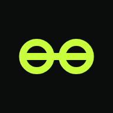

<div align="center">



# LiftLens

**拍一组，自动测量；用你自己的 AI 当教练点评，视频不离开你的设备。**

姿态识别、杠铃追踪和计次全部在浏览器里完成。教练点评由你选的 AI 完成：填自己的 key 调用云端 API，或者用电脑上已登录的 Claude Code / Codex。

**[在线使用 → liftlens.dobbylab.com](https://liftlens.dobbylab.com)**

[English](README.md) · 简体中文

[](LICENSE)


</div>

## 功能

- **浏览器里分析视频**：MediaPipe Pose 或 OpenMMLab RTMO（按需下载）、杠铃颜色追踪、自动分次，支持卧推 / 深蹲 / 硬拉的专项规则和动作库里 800 多个动作。所有阈值都按身体比例归一化，每条判定都附文献出处。
- **训练模式**：粘贴计划，每组拍一段（或打开摄像头实时计次、语音提示）。拍完在后台分析，组间休息时就能看到这一组的问题和下一组建议。
- **自带教练**：5 套教练 skill（IPF 裁判、NSCA-CSCS、东欧周期化、康复理疗师、大众健身），可以运行在：
  - **云端 API**，浏览器直接调用：Claude、OpenAI、Gemini、OpenRouter、通义千问、豆包、Kimi、硅基流动、DeepSeek 或任意 OpenAI 兼容接口；
  - **本地 agent**，在你的电脑上调用 Claude Code、Codex CLI、Gemini CLI、Qwen Code、OpenCode、Ollama 或 LM Studio。
- **本地优先**：训练记录和视频保存在浏览器的 IndexedDB，可以导出 / 导入 JSON 备份，可以添加到主屏幕。
- **能力曲线**：预估 1RM 和动作分趋势、反复出现的问题、每周肌肉图，以及 AI 生成的能力报告。

## 原理

程序负责**测量**，教练负责**判断**。两者分开，测量结果可以复现；教练还会结合叠加了骨架的关键帧，交叉核对程序的结果（比如手臂被杠铃片挡住时）。架构图见 [英文 README](README.md#how-it-works)。

## 快速开始

### 使用

打开 [liftlens.dobbylab.com](https://liftlens.dobbylab.com)（或你自己部署的站点），在「AI 教练」里选择点评方式：

| | 需要 |
|---|---|
| **云端 API** | 任意一家支持的厂商的 API key，手机也能用 |
| **本地 agent** | 电脑上有 Node.js 20+ 和已登录的 Claude Code / Codex 等，运行页面上的那行 `npx` 命令。只能在同一台电脑的浏览器里用（网页直接访问 `127.0.0.1`） |

### 开发

```bash
git clone https://github.com/dobbylabhq/liftlens.git && cd liftlens
npm run setup   # 安装 web 和 agent 依赖
npm run dev     # 网页 http://localhost:5180 + 本地 agent 127.0.0.1:4517
```

本地开发不需要任何配置。`npm run web` 只启动网页，`npm run agent` 只启动本地 agent，`cd web && npx tsc -b && npm run lint` 做类型检查和 lint。

### 本地 agent 命令

```bash
npx -y <站点>/agent/liftlens-agent.tgz            # 启动并和浏览器配对
npx -y <站点>/agent/liftlens-agent.tgz install    # 后台运行、开机自启（macOS / Linux）
npx -y <站点>/agent/liftlens-agent.tgz use <id>   # 切换点评工具，例如 use qwen --key … --model …
```

## 部署

LiftLens 是部署在 Cloudflare Workers 上的静态站点。服务端只有一个很小的 Worker，作用是让缺失的 `/assets/*` 返回 404。没有后端：用户的 AI、key 和训练数据都不会经过你的部署。

```bash
cp .env.example .env          # 填 LIFTLENS_SITE（你的 workers.dev 或自定义域名）
npx wrangler login
scripts/deploy.sh
```

部署脚本还会把教练 skills 和带版本号的 agent 安装包一起发布到站点上，用户不需要 npm 账号就能用 `npx` 运行。用你的站点的人会在自己电脑上运行这个包，等于信任你部署的代码；不想这样的人可以 clone 仓库，用 `npm run agent` 自己跑。

## 隐私

LiftLens 没有账号，也没有后端数据库。完整说明见站内的[隐私说明](https://liftlens.dobbylab.com/privacy)。

**数据存在哪儿**：训练计划、每组记录、视频、关键帧、分析结果、教练点评、你主动填写的个人资料（身高、体重、训练年限、目标、伤病史）和设置（包括云端 API key），都只保存在当前浏览器的 IndexedDB 里，不会上传到 LiftLens 的服务器。清除网站数据、换浏览器或换设备、用无痕模式都会丢失；可以在训练日志里导出备份（JSON，不含视频和 API key），再在别处导入。

**什么时候数据会离开你的设备**：只有请 AI 教练点评时，而且只发给你选的那一方：

- **云端 API**：浏览器把测量数据、几张叠加了骨架的关键帧和你的个人资料直接发给你选的厂商，用你自己的 key。以该厂商的隐私政策为准。
- **本地 agent**：同样的内容发给你自己电脑上的 agent（只监听 `127.0.0.1`，需要配对码），由它调用你已登录的 Claude Code、Codex 等。

原始视频永远不会被发送。用「只记录」模式或不请教练点评时，不会发送任何训练数据。

**网站本身会接触到什么**：网站是部署在 Cloudflare 上的静态文件，Cloudflare 会处理 IP 地址等普通请求信息。姿态模型和字体从 Google（MediaPipe、Google Fonts）、jsDelivr、Hugging Face 下载。没有统计脚本、广告或追踪 Cookie。

**本地 agent 的文件**：`~/.liftlens/` 里有配对码、运行时设置和 API key（`config.json`，权限 0600）、教练 skills 缓存和日志，删除这个目录即可清除。

## 局限

- 规则阈值主要用卧推侧拍视频校准，深蹲和硬拉还需要更多真实视频验证。
- 单机位 2D 角度在斜向机位下会受透视影响，细节判断交给教练结合关键帧核对。
- 数据只在一个浏览器里，清除站点数据或换浏览器会丢失，记得导出备份。

## 参与贡献

欢迎提 issue 和 PR。提交前请跑类型检查和 lint，代码注释请用英文，并说明你在什么设备和浏览器上测试过。

## 许可证

[MIT](LICENSE)。第三方许可证见 [NOTICE.md](NOTICE.md)。

> [!WARNING]
> LiftLens 提供的是训练反馈，不是医疗建议。量力而行，大重量请有保护或使用安全杠。
